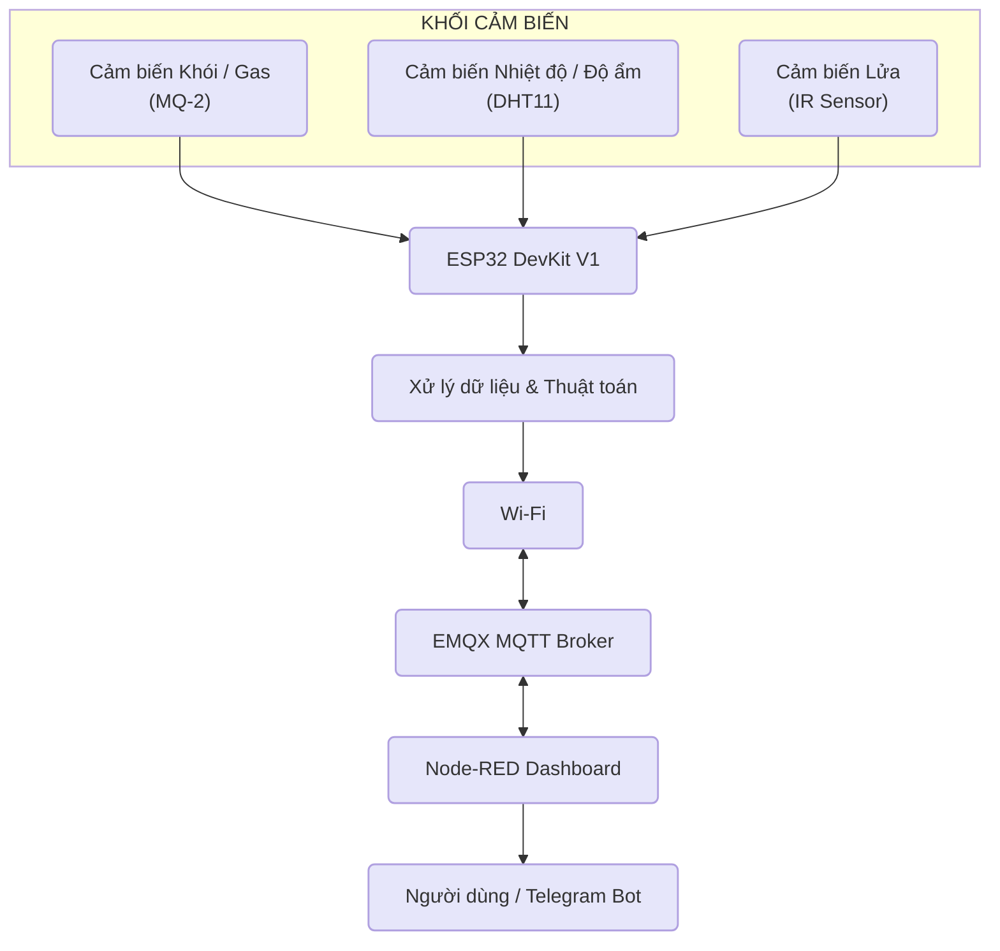

# Du-an-cuoi-ky1
#  Hệ Thống Báo Cháy & Cảnh Báo Sớm Thông Minh
> **Môn học:** Hệ thống nhúng & IoT  
> - Sinh viên thực hiện: Lê Văn Đạt 
> - MSSV:23001592
> - Lớp: K68 Kỹ thuật điện tử và tin học

# 1. Đặt Bài Toán & Tính Ứng Dụng 
Hiện nay, nguy cơ cháy nổ tại các hộ gia đình, chung cư mini, kho xưởng diễn ra ngày càng phức tạp và để lại hậu quả nghiêm trọng. Hầu hết các hệ thống báo cháy truyền thống hiện nay chỉ phát ra âm thanh tại chỗ, dẫn đến việc:
- Người dân không hay biết nếu đang ở xa hoặc đang ngủ say.
- Tỷ lệ báo động giả cao do chỉ dựa vào một thông số duy nhất (chỉ đo khói hoặc chỉ đo nhiệt độ).
- Chưa có giải pháp chủ động xử lý ngắt nguồn điện hoặc van gas tự động khi phát hiện sự cố.
# Giải pháp đề xuất:
Dự án **"Hệ Thống Báo Cháy & Cảnh Báo Sớm Thông Minh dựa trên ESP32 và Node-RED"** giúp:
- Theo dõi liên tục các chỉ số môi trường (Khói, Nhiệt độ, Độ ẩm, Vệt lửa).
- Đánh giá nguy cơ bằng thuật toán xử lý đa cảm biến để tránh báo động giả.
- Cảnh báo tức thì qua còi hú tại chỗ, bảng điều khiển Node-RED Dashboard và gửi thông báo khẩn cấp qua Telegram Bot.
- Tự động kích hoạt thiết bị hạ nhiệt/chữa cháy (Servo ngắt van, Rơ-le bật bơm/quạt).
# 2. Tính Sáng Tạo & Điểm Nổi Bật
- Thuật toán đánh giá rủi ro đa tầng: Cảnh báo được phân loại theo các cấp độ (*An toàn -> Nguy cơ -> Báo động cháy khẩn cấp*) dựa trên sự kết hợp giữa cảm biến lửa IR và cảm biến khí nồng độ cao.
- Tự động hóa hành vi an toàn :Ngoài phát âm thanh cảnh báo, hệ thống lập tức điều khiển Servo ngắt van cấp gas và kích hoạt Rơ-le điều khiển quạt hút khói/bơm nước.
- Giao thức truyền dữ liệu MQTT tối ưu: Dùng MQTT truyền dữ liệu lên Broker trung gian theo cơ chế Publish/Subscribe , đảm bảo độ trễ cực thấp.
# 3. Sơ Đồ Khối Hệ Thống (System Block Diagram)

# 4 Tóm tắt bài toán  
- Nền tảng lập trình: PlatformIO / Arduino IDE (Ngôn ngữ C/C++)
- Giao thức mạng: MQTT (sử dụng thư viện PubSubClient)
- MQTT Broker Online: EMQX Broker
- Giao diện & Cảnh báo: Node-RED (Node-RED Dashboard)                                    
